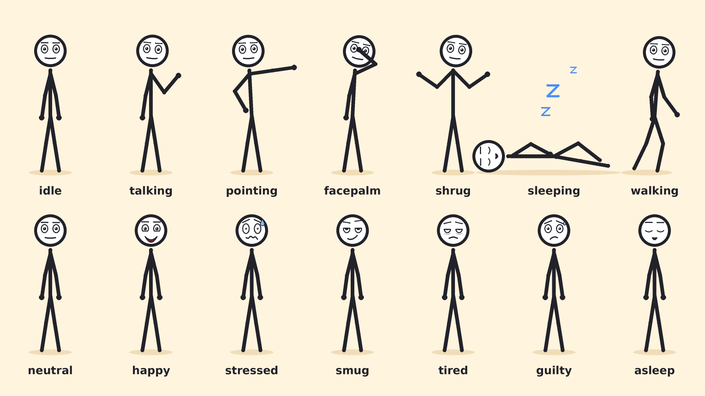
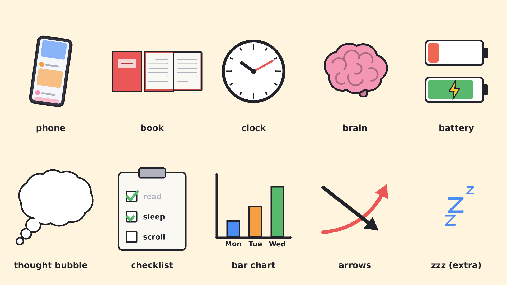

# stickvid

Vertical stick-figure videos (1080x1920, 30 fps) in plain Python. Pillow draws
the frames, ffmpeg (called through `subprocess`) assembles the MP4.




## Install

You need Python 3.9+ and ffmpeg.

**1. ffmpeg**

```bash
# macOS (Homebrew)
brew install ffmpeg
```

```bash
# Ubuntu / Debian
sudo apt update && sudo apt install -y ffmpeg
```

```bash
# Windows (PowerShell) - then open a new terminal
winget install Gyan.FFmpeg
```

Check it is on your PATH:

```bash
ffmpeg -version
```

**2. Python dependencies** (from the repository root)

```bash
python3 -m venv .venv
```

```bash
source .venv/bin/activate        # Windows: .venv\Scripts\activate
```

```bash
pip install -r requirements.txt
```

The only dependency is Pillow (>= 10.1).

## Render

```bash
python make_test_video.py
```

Writes `output/test_video.mp4`: 10 seconds, figure scrolls on a phone, feels
guilty, drops the phone and opens a book. Takes about 25 seconds.

| Flag | Effect |
| --- | --- |
| `--guides` | tints everything outside the safe zone red, to check your layout |
| `--fast` | turns supersampling off for a quick, slightly jagged preview |
| `--out PATH` | output file |

```bash
python make_showcase.py
```

Regenerates the two reference sheets above (every pose, expression and prop).

## Layout

```
stickvid/
  config.py    frame size, fps, safe zone, colours
  easing.py    easing curves (cubic, back, bounce, elastic...) and lerp helpers
  timeline.py  Track: keyframed values with eased transitions
  canvas.py    Canvas: supersampled drawing surface in logical 1080x1920 coords
  figure.py    StickFigure, Pose, Face, POSES, EXPRESSIONS, walk_cycle
  props.py     phone, book, clock, brain, battery, thought_bubble, checklist,
               bar_chart, arrow (+ zzz, backdrop)
  camera.py    Camera, CameraRig (zoom-in, shake), slide_transition
  video.py     VideoWriter: pipes raw frames into ffmpeg
make_test_video.py   the 10-second demo, a worked example of everything
make_showcase.py     reference sheets
```

## Safe zone

App UI covers the top 250px and bottom 400px. `config.SAFE_BOX` is
`(60, 250, 1020, 1520)`. Backgrounds fill the whole frame; anything the viewer
has to see goes inside the box. Two things help you stay there:

- `--guides` (or `draw_safe_guides(frame)`) shows the covered areas.
- The camera zooms around the centre of the safe zone, not the frame, so the
  thing you zoom in on lands where it is visible.

Zooming enlarges everything, so objects near the edge of the safe zone will
drift out of it during a zoom. In the demo the clock does this while the
camera is on the face. Check with `--guides` when you add a zoom.

## Writing a scene

Everything is a function of time `t` in seconds. You schedule transitions
once, then ask for the state at each frame.

```python
from stickvid import Canvas, CameraRig, StickFigure, VideoWriter, config, props
from stickvid.easing import ease_out_back, progress

fig = StickFigure(x=540, ground_y=1470, pose="idle", expression="neutral")
fig.pose_to("pointing", at=1.0, duration=0.4, ease=ease_out_back)  # eased pose change
fig.expression_to("smug", at=1.0)
fig.look_to((0.8, 0.0), at=1.0)       # gaze: x and y in -1..1
fig.talk(1.5, 3.0)                    # flap the mouth
fig.walk_to(300, start=3.0, end=4.5)  # walk cycle + movement

cam = CameraRig()
cam.zoom_to(1.4, center=(540, 800), at=1.0, duration=0.6)
cam.reset(at=2.5)
cam.shake(at=3.0, amplitude=20)

with VideoWriter("output/my_video.mp4") as video:
    for i in range(5 * config.FPS):
        t = i / config.FPS
        fig.update(t)
        c = Canvas()
        props.backdrop(c, 1470)
        props.bar_chart(c, 780, 600, grow=progress(t, 1.0, 2.0))
        fig.draw(c)
        video.write(c.to_frame(cam.at(t)))
```

**Poses:** `idle`, `talking`, `pointing`, `facepalm`, `shrug`, `sleeping`,
`walking`, plus `scrolling`, `hold_book`, `read_book` for the demo. A pose is a
`Pose` dataclass of joint angles; add your own to `POSES` or pass a `Pose`
straight to `pose_to`. The angle convention is at the top of `figure.py`.

**Expressions:** `neutral`, `happy`, `stressed`, `smug`, `tired`, plus `guilty`
and `asleep`. Same idea: a `Face` dataclass (lids, brows, pupils, mouth curve,
sweat...) that blends smoothly between any two expressions.

**Holding props:** joint positions are in `fig.joints` after `update()`
(`r_hand`, `l_hand`, `head`, ...). Draw the prop there, then call
`fig.draw_hands(c)` so the hand sits on top. See `ScrollScene._held_phone`.

**Slide transition:** render both scenes and combine them:
`slide_transition(frame_a, frame_b, t, start, duration, "left")`.

## Notes

- Frames are drawn at 2x and scaled down for anti-aliasing (`config.SSAA`).
- The MP4 is H.264 / yuv420p / faststart with no audio track. Add sound in your
  editor, or mux it: `ffmpeg -i output/test_video.mp4 -i voice.m4a -c:v copy -c:a aac -shortest final.mp4`
- Text uses DejaVu Sans Bold or Arial Bold if found, otherwise Pillow's
  built-in font. Add your own font path to `_FONT_CANDIDATES` in `canvas.py`.
